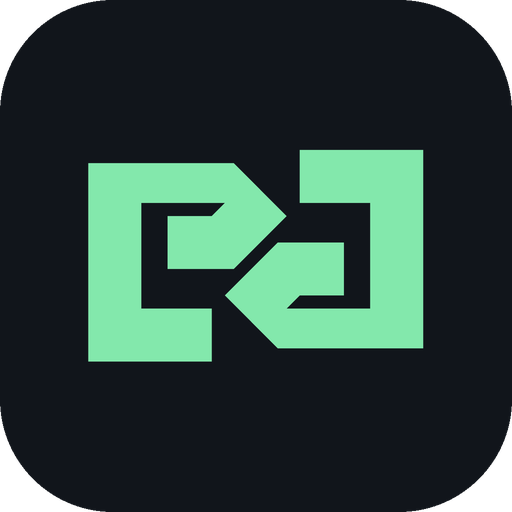

# Meikova Relay

<div align="center">



[](https://github.com/Meikova/meikova-relay/actions/workflows/build-release.yml)
[](https://github.com/Meikova/meikova-relay/releases)
[](https://github.com/Meikova/meikova-relay)
[](https://github.com/Meikova/meikova-relay)
[](LICENSE)

**Hệ thống điều khiển máy tính từ xa thế hệ mới: Độ trễ siêu thấp, chuẩn màu 1:1 Pixel-Perfect, truyền tải âm thanh trực tiếp và vượt qua 100% tường lửa doanh nghiệp.**

[Dùng Thử Web Client](https://meikova-relay.onrender.com) | [Tải Gói Máy Trạm](https://github.com/Meikova/meikova-relay/releases) | [Tài Liệu Triển Khai](docs/DEPLOYMENT_GUIDE.md)

</div>

---

## 1. Tổng quan hệ thống

Meikova Relay là giải pháp Remote Desktop toàn diện, độc lập, được thiết kế tối ưu cho:

- **Môi trường mạng doanh nghiệp khắt khe**: Hoạt động ổn định trong mạng chặn toàn bộ giao thức UDP, không có IPv6 công cộng và không thể mở cổng (Port Forwarding).
- **Bảo mật Outbound-Only**: Máy trạm (Host Agent) chỉ mở kết nối một chiều từ trong ra ngoài tới Relay Server qua cổng tiêu chuẩn **443 (HTTPS/WSS)**.
- **Client Zero-Install**: Người điều khiển sử dụng trình duyệt web hiện đại (Chrome, Edge, Safari, Firefox trên PC, Mac, iPad, iPhone, Android) mà không cần cài thêm plugin.

```
+-----------------------------------------------------------------------------------------+
|                                LUỒNG TRUYỀN DẪN DỮ LIỆU                                 |
+-----------------------------------------------------------------------------------------+

 [MÁY TRẠM (HOST AGENT)]                                   [NGƯỜI ĐIỀU KHIỂN (WEB CLIENT)]
 - Windows (Win32 GDI / DXGI)                              - HTML5 Canvas 2D / Offscreen
 - Linux (X11 / Scrot)                                     - Bàn phím / Chuột / Cảm ứng
 - macOS (CoreGraphics / ScreenCapture)                    - Web Audio 48kHz Stereo Loopback
         \                                                         /
          \---- [ Outbound WSS:443 ]                     [ HTTPS / WSS:443 ] ----/
                                    \                   /
                                     v                 v
                    +----------------------------------------------------+
                    |         MEIKOVA RELAY SERVER (Node.js Engine)      |
                    |  - Bộ định tuyến WebSocket Room ID / PIN an toàn   |
                    |  - Google OAuth 2.0 (GIS) & JWT Session Manager    |
                    |  - Nhật ký kiểm toán bảo mật (Audit Log Trail)     |
                    +----------------------------------------------------+
```

---

## 2. Tính năng nổi bật

### Sao chép màn hình 1:1 Pixel-Perfect và tự động đàm phán ma trận

- **1:1 Native Replica**: Hiển thị chính xác từng điểm ảnh gốc không nén vỡ hình (`image-rendering: pixelated; crisp-edges`). Hỗ trợ kéo di chuyển khung hình (Pan) bằng chuột giữa hoặc `Alt + Chuột trái` khi máy trạm có độ phân giải lớn hơn thiết bị điều khiển.
- **Tự động đo đạc và cấu hình thích ứng**:
  - Tần số quét >= 120Hz: Tự động kích hoạt Ultra 120 FPS.
  - Màn hình độ phân giải cao: Kích hoạt Crisp 2K / 4K với thuật toán xử lý độ nét cao.
  - Chế độ điều chỉnh linh hoạt: 1:1 Chuẩn Gốc, Cân bằng (30 FPS), Siêu mượt (60 FPS), Tiết kiệm băng thông.
- **Hỗ trợ đa màn hình (Multi-Monitor)**: Nhận diện danh sách màn hình gắn trên máy trạm, chuyển đổi giữa Màn 1, Màn 2 hoặc hiển thị gộp toàn cảnh.

### Giao diện Ambient Instrument UI

- Thiết kế theo triết lý tối giản, tập trung vào tín hiệu với bảng màu tối chuyên sâu OKLCH.
- **100% Inline Vector SVG**: Không phụ thuộc font icon hay tài sản hình ảnh bên ngoài; toàn bộ biểu tượng hiển thị qua SVG inline chuẩn pixel.
- **Thanh công cụ Floating Deck đa chế độ**:
  - Deck nổi (Pill Deck): Cố định góc dưới màn hình.
  - Ghim mép trên (Top Pin): Tối ưu diện tích quan sát.
  - Ẩn mép trên (Top Unpin): Tự động trượt ẩn lên cạnh trên, chỉ hiển thị khi rê chuột tiếp cận.

### Truyền tải âm thanh thời gian thực (Audio Streaming)

- Tự động bắt âm thanh hệ thống (WASAPI Loopback Capture) định dạng PCM 16-bit / 48kHz Stereo.
- Phát lại độ trễ thấp trên Web Client qua HTML5 Web Audio API (AudioContext).

### Trải nghiệm điều khiển di động toàn diện (Mobile Touch & Responsive)

- **Động cơ cử chỉ cảm ứng (Touch-First Controller)**:
  - Chạm 1 ngón (Single Tap): Gửi chuỗi sự kiện Click hoàn chỉnh kèm hiệu ứng sóng phản hồi Cyan trực quan.
  - Nhấp đúp (Double Tap): Gửi Double Click nguyên bản.
  - Nhấn giữ 450ms (Long Press): Kích hoạt Chuột phải (Right Click) kèm rung phản hồi xúc giác (`45ms`).
  - Nút chuột phải chuyên dụng: Tích hợp trực tiếp trên Floating Deck cho thao tác chính xác tức thì.
  - Cử chỉ 2 ngón: Vuốt cuộn trang (Mouse Wheel) và Chụm thu phóng (Pinch Zoom).
- **Cầu nối bàn phím ảo (Native Soft Keyboard Bridge)**: Mở bàn phím ảo gốc của điện thoại/máy tính bảng, nhập liệu ký tự Unicode tiếng Việt và phím chức năng (`Backspace`, `Enter`, `Tab`, `Esc`).
- **Thanh phím tắt nhanh (Mobile Quick Keys Bar)**: Thao tác 1-chạm với các phím thông dụng (`Ctrl+Alt+Del`, `Esc`, `Tab`, `Win`, `Space`, `Enter`, `Back`, `Alt+Tab`).
- **Mở khóa máy trạm từ xa (Remote Lock Screen Unlock)**: Gửi tổ hợp phím `Ctrl+Alt+Del` qua mã quét phần cứng (Hardware Scan Codes) để đánh thức và đăng nhập máy trạm Windows từ màn hình khóa.
- **Tối ưu hiển thị Stage & Safe Area**: Tự động mở rộng Canvas stage toàn màn hình (`100vw x 100dvh`), triệt tiêu thanh cuộn trang thừa và bảo vệ vùng an toàn (`env(safe-area-inset-*)`) tránh bị che khuất bởi Dynamic Island / camera notch khi xoay ngang (Landscape).

### Bộ công cụ quản trị hệ thống từ xa

- **Quản lý tệp tin hai chiều (File Manager)**: Duyệt cây thư mục máy trạm, tải lên/tải xuống tệp tin, xem nội dung văn bản từ xa, xác thực mã băm SHA-256 bảo đảm tính toàn vẹn.
- **Terminal dòng lệnh trực tiếp (Remote CLI)**: Tích hợp PowerShell (Windows) và Bash (Linux/macOS), hỗ trợ tiếng Việt có dấu (UTF-8).
- **Giám sát tiến trình (Process Manager)**: Theo dõi danh sách tiến trình sử dụng tài nguyên CPU / RAM và hỗ trợ dừng tiến trình từ xa.
- **Điều khiển nguồn điện (Power Control)**: Khóa màn hình (Lock), Khởi động lại (Restart), Tắt máy (Shutdown) có đếm ngược và cho phép hủy lệnh khẩn cấp.
- **Đồng bộ bộ nhớ tạm (Clipboard Sync)**: Tự động đồng bộ nội dung văn bản giữa máy trạm và trình duyệt điều khiển.

### Bảo mật đa tầng cấp doanh nghiệp

- Mã hóa toàn bộ luồng truyền dẫn bằng TLS 1.3 (HTTPS / WSS).
- Xác thực hai lớp: Tài khoản người dùng kết hợp mã PIN phòng ngẫu nhiên 6 chữ số.
- Cơ chế chống dò quét (Brute-Force Protection): Tự động khóa phòng tạm thời khi nhập sai mã PIN nhiều lần.
- Xác thực hiện đại: Hỗ trợ Google Identity Services (GIS) 1-click và JWT Bearer Tokens.
- Nhật ký kiểm toán (Audit Logging): Ghi nhận toàn bộ lịch sử phiên kết nối, địa chỉ IP và danh tính thiết bị.

---

## 3. Danh mục gói cài đặt máy trạm (Downloads)

Gói cài đặt được biên dịch và đóng gói tự động qua GitHub Actions CI/CD:

| Hệ điều hành | Tệp phát hành | Định dạng | Mô tả |
| :--- | :--- | :--- | :--- |
| Windows | [`MeikovaRelayHost.exe`](https://github.com/Meikova/meikova-relay/releases/latest) | Portable Exe | Chạy trực tiếp không cần quyền Quản trị viên (Admin) |
| Windows | [`MeikovaRelayHost-windows-x64.zip`](https://github.com/Meikova/meikova-relay/releases/latest) | Zip Archive | Bộ cài đặt đầy đủ kèm hướng dẫn cấu hình dịch vụ |
| Linux | [`meikova-relay-host_amd64.deb`](https://github.com/Meikova/meikova-relay/releases/latest) | Debian / Ubuntu | Gói cài đặt tích hợp App Icon và Systemd service |
| Linux | [`meikova-relay-host-linux-x64.tar.gz`](https://github.com/Meikova/meikova-relay/releases/latest) | Tarball | Dành cho các bản phân phối Linux khác (Fedora, Arch, RHEL) |
| Linux | [`meikova-relay-host`](https://github.com/Meikova/meikova-relay/releases/latest) | Standalone ELF | Tệp thực thi nhị phân cho Server / CLI |
| macOS | [`meikova-relay-host-macos.tar.gz`](https://github.com/Meikova/meikova-relay/releases/latest) | Tarball | Gói cài đặt macOS kèm cấu hình LaunchAgent |
| macOS | [`MeikovaRelayHost`](https://github.com/Meikova/meikova-relay/releases/latest) | Mach-O Binary | Tệp thực thi chạy trực tiếp từ Terminal macOS |
| Đối soát | [`SHA256SUMS.txt`](https://github.com/Meikova/meikova-relay/releases/latest) | Text | Bảng mã băm SHA-256 đối chiếu tính toàn vẹn |

---

## 4. Hướng dẫn bắt đầu nhanh (Quick Start)

### Bước 1: Khởi động máy trạm (Host Agent)

1. Tải bản phù hợp từ [GitHub Releases](https://github.com/Meikova/meikova-relay/releases/latest).
2. Chạy ứng dụng `MeikovaRelayHost`:
   - Giao diện hiển thị **ID Máy Trạm** (Room ID) và **Mã PIN Kết Nối**.
   - Tùy chọn cài đặt cấp Người dùng (User) tự khởi động cùng máy, hoặc Dịch vụ Hệ thống (Admin Service) chạy nền 24/7.

### Bước 2: Điều khiển từ xa (Web Client)

1. Truy cập cổng Web Hub: [https://meikova-relay.onrender.com](https://meikova-relay.onrender.com).
2. Đăng nhập tài khoản hoặc chọn Đăng nhập bằng Google.
3. Chọn thiết bị trong danh bạ hoặc bấm Kết nối nhanh, nhập Room ID và PIN.
4. Màn hình máy tính hiển thị ngay lập tức với đầy đủ thao tác chuột và phím.

---

## 5. Hướng dẫn triển khai máy chủ riêng (Self-Hosted)

Chi tiết xem tại: [Tài liệu Triển Khai Hệ Thống (DEPLOYMENT_GUIDE.md)](docs/DEPLOYMENT_GUIDE.md)

Lệnh khởi chạy máy chủ Node.js:

```bash
git clone https://github.com/Meikova/meikova-relay.git
cd meikova-relay/relay-server
npm install
npm start
```

*Máy chủ mặc định lắng nghe tại cổng `8080` (HTTP + WebSocket).*

---

## 6. Triển khai Docker (Container-Native)

Dự án hỗ trợ triển khai máy chủ độc lập 100% thông qua Docker và Docker Compose, tích hợp sẵn Node.js 22-slim và công cụ đường hầm cloudflared:

`ash
# Khởi chạy máy chủ relay
docker compose up -d

# Xem logs trực tiếp
docker compose logs -f

# Tự động mở Cloudflare Quick Tunnel xuyên tường lửa/NAT
AUTO_TUNNEL=1 docker compose up -d
`

Máy chủ lắng nghe tại cổng 8080 (HTTP + WebSocket). Dữ liệu được lưu trữ bền vững tại ./data/meikova-relay.db.

---

## 7. Đường hầm Cloudflare Quick Tunnel (Universal Tunnel Bridge)

Tích hợp sẵn Cloudflare Quick Tunnel (	rycloudflare.com) cho phép truy cập Web UI và kết nối máy trạm từ Internet không cần cấu hình port forwarding:

- **Khởi động kèm Tunnel:** 
ode server.js --tunnel (hoặc AUTO_TUNNEL=1 trong Docker)
- **Quản trị API:**
  - GET /api/tunnel/status - Trạng thái hoạt động và URL công khai (https://*.trycloudflare.com)
  - POST /api/tunnel/start - Bật đường hầm
  - POST /api/tunnel/stop - Tắt đường hầm
  - POST /api/tunnel/restart - Khởi động lại đường hầm

---

## 8. Kiểm thử và xác minh chất lượng (Testing)

Hệ thống tuân thủ quy chuẩn kiểm thử nghiêm ngặt:

```bash
python -m unittest discover tests
```

Kết quả kiểm thử tự động:
- Test Suite: 67/67 tests đạt trạng thái PASS (Exit Code 0).
- CI/CD Matrix: Biên dịch và kiểm thử tự động trên Windows, Ubuntu và macOS.

---

## 9. Giấy phép bản quyền (License)

Dự án được phát hành theo giấy phép mã nguồn mở **MIT License**.
Bản quyền thuộc về **Meikova Relay Team © 2026**.

---

## 10. Hệ sinh thái Meikova

- [Meikova Harvest](https://github.com/Meikova/meikova-harvest) - Hệ sinh thái trích xuất và tải đa phương tiện đa nền tảng.
- [Meikova Loop](https://github.com/Meikova/meikova-loop) - DJ mashup và infinite soundscape engine chạy trên web, desktop và mobile.
- [Meikova Relay](https://github.com/Meikova/meikova-relay) - Điều khiển máy tính từ xa độ trễ thấp, outbound-only.
- [Meikova Auth](https://github.com/Meikova/meikova-auth) - Cổng xác thực tập trung, Universal SSO Ed25519 và quản lý danh tính đa nền tảng.
- [Meikova Balance](https://github.com/Meikova/meikova-balance) - Quản lý tài chính cá nhân, chia hóa đơn nhóm và trợ lý AI đa tầng.
- [Meikova Campus](https://github.com/Meikova/meikova-campus) - Nền tảng thương mại khóa học, phân quyền Google Drive tự động và LMS trực tuyến.
- [Meikova Exchange](https://github.com/Meikova/meikova-exchange) - Sàn giao dịch B2B cho dự án phần mềm, mã nguồn và tài sản số.
- [Meikova Traverse](https://github.com/Meikova/meikova-traverse) - Trình duyệt tệp tin cục bộ, SFTP, WebDAV và quản lý lưu trữ đa nền tảng.
- [Meikova Shield](https://github.com/Meikova/meikova-shield) - Hệ thống phòng thủ an ninh mạng và phát hiện web defacement bằng học máy lai ghép.
- [Meikova Vision](https://github.com/Meikova/meikova-vision) - Bộ công cụ xử lý ảnh RAW, ghép đa phơi sáng HDR và tone mapping chuyên nghiệp.
- [Meikova Flow](https://github.com/Meikova/meikova-flow) - Động cơ trích xuất, biến đổi, nạp dữ liệu (ETL) và tự động hóa luồng báo cáo.
